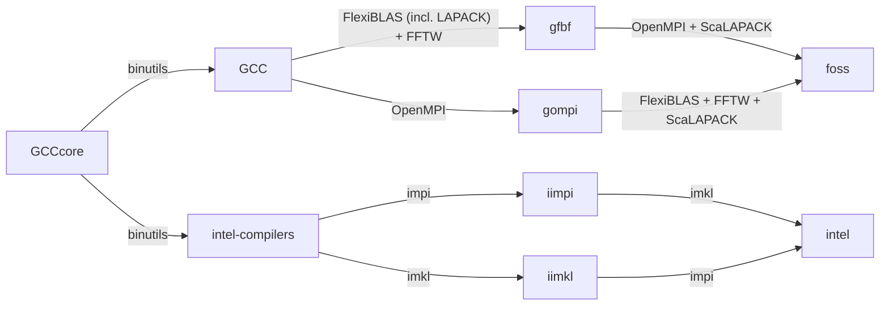
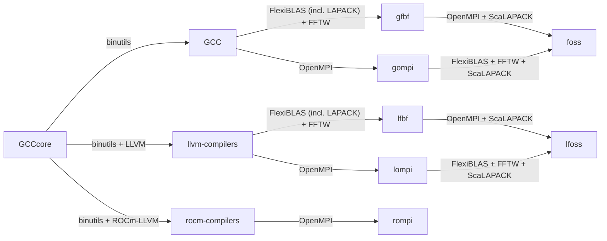
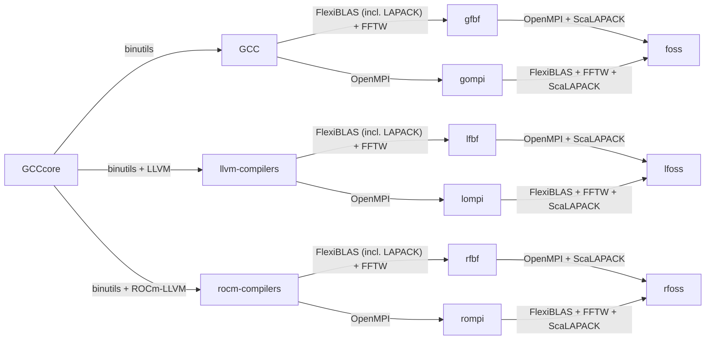

# Basic concepts

## Steps in software installation

<figure markdown style="border: 1px solid #000">
  { loading=lazy }
</figure>

A typical software installation consists of a number of steps, though not all of these steps
may be present in every installation:

1.  Fetch the sources and unpack them. Often the sources can just be downloaded from the internet.
    Some programs may have a mandatory registration even if they are free to use (such as NAMD), 
    and software with paying licenses often requires a manual download after logging in to the
    website of the vendor. 

    Protection against AI scrapers is also making downloads more difficult these days. Downloads using
    `wgt` or `curl` may fail and sites may force a manual download via a web browser instead.

2.  Sometimes patches need to be applied for known bugs (or in the case of EasyBuild and Spack, to make
    the installation process more compatible with the tool), and in other cases, a user may want to apply
    a patch that extends the package.

3.  Create a build environment: Sometimes it is better not to build in the software directory. And one may
    need to load other modules, such as compilers, build tools, or modules for other libraries that the
    package uses (dependencies).

4.  Many software packages come with a configure tool to set up the options that need to be compiled in the
    package. That tool will also check for system-specific properties as not all Linux distributions are equal
    and as many packages also support other operating systems. The two most popular ones are the configure script
    generated by [GNU Autotools](https://en.wikipedia.org/wiki/GNU_Autotools)
    and [CMake](https://cmake.org/). The first one is a tool developed specifically for a GNU UNIX-compatible
    environment while CMake can also works with other operating systems (even Windows).

    Some Python-based tools are (unfortunately) also becoming more popular, such as
    [Meson](https://mesonbuild.com/) and [SCons](https://scons.org/).
    These tools tend to cause a lot more issues on LUMI. In general, a good build tool does not interfere at all
    with the software it is trying to install and hence can be built in a way that it has no runtime dependencies
    of its own, and the Python build tools do violate that assumption.

    And some packages come with their own configuration and build tools which is rarely a good idea. They may be adapted very
    well to the software their trying to install, but their developers usually lack the knowledge about all possible
    environments a package may be used with, only leading to more issues.

    Other packages lack any proper configuration tool, and users must edit the Makefile (or a file included in the
    Makefile). VASP is a notorious example, and CP2K for a long time also did not use a proper configuration tool.

5.  Build the software. The most popular tool for this is still make, but there are other options also, with ninja
    also gaining in popularity. Some tools mentioned above as configuration tools are also really a complete build
    environment and can be used in the build step and the forthcoming install step also. One example is CMake that 
    during the configuration phase can create input file for make or ninja, but can also be used directly to build
    and install software. Autotools does also use make, but that then often calls libtool to add options to compilers
    and linkers, so Autotools is also more than just a configuration tool but can be a complete build tool when
    combined with some other GNU packages.

6.  In some cases, some testing can already be done after the build step and before the software is installed in the
    final location. This is a good moment to, e.g., detect compiler-induced issues, as in some codes some compiler
    optimisations may lead to wrong results (though this is often really a source code issue rather than a 
    compiler issue).

7.  Install the software. It is a good idea to do that as a separate step and to build the software in the source
    directories or a separate build directory. As such, the build process will not damage an already present installation
    leaving the user with nothing if the build process fails. And it is then also possible to build the software 
    on a filesystem with optimal performance for building.

    In fact, it is a good idea to do all previous steps, from unpacking the software to building the software, on a 
    RAM disk or local SSD for optimal performance, and only at the end copy to the parallel filesystems of LUMI. 
    After all, building software involves working with lots of small files, something that a parallel filesystem
    doesn't really like.

8.  You may then want to run some sanity checks, though this may require some work of the next step first. Are all 
    the files that you would expect really installed? Can a binary find all shared libraries that it needs?

9.  Finally, it is good to double-check the permissions: Can everybody who needs to use the package also read and 
    execute the software? And at the end, the software can be made more easily available to others by installing
    a module at the right location in the module tree.

<figure markdown style="border: 1px solid #000">
  { loading=lazy }
</figure>

Many packages follow a very standard install procedure, e.g.,

-   Autotools packages: `configure` — `make` — `make install`, with a lot of standard options for the `configure`
    command to set the compilers and some compiler flags and the install location.

-   CMake packages: `cmake` — `make` — `make install` (though there are other options with CMake also), again with
    a lot of standard options for the `cmake` command to set the compilers and some compiler flags and the install location.

-   Installing from a binary: Unpack the files and copy to the right location.

-   Installing a package from PyPi using `pip` (though note that you may not want to use a precompiled wheel but install
    from sources to get the most out of binaries for those packages that contain libraries and not just pure Python code).

However, some software comes with its own procedures. Examples are scripts that first ask a lot of questions to configure
a package, popular with commercial software, or OpenFOAM which only supports in-place builds and uses its own `wmake` tools.

Packages installed through a configuration tool can have a lot of options, including a lot of standardised ones to pass
compiler choice and flags and installation directories, and a lot of custom ones to configure the package for a specific
purpose. And unfortunately, one size does not always fit all. Some libraries need different conflicting combinations of
options depending what code they will be used with.

## The installation process implemented in EasyBuild

<figure markdown style="border: 1px solid #000">
  { loading=lazy }
</figure>

EasyBuild is Python code that implements this installation process in three layers of abstraction:

-   **Framework** defines an **abstract installation procedure** with all the steps given above.
    It also provides a lot of routines that help implementing the next layers more easily,
    including the code to generate modulefiles and the code to control compiler flags, etc.,
    the so-called toolchains that we will discuss later.

-   **Easyblock**: This is a Python module that implements a **specific installation process**.
    We distinguish two types of Easyblocks:

    -   **Generic easyblocks** implement standard installation processes, e.g., `cmake` — `make`— `make install`.

    -   **Software-specific easyblocks** are for installations that do not follow a standard installation process,
        e.g., OpenFOAM. Some software-specific easyblocks are for packages with a very standard installation process
        and could be installed easily with a generic easyblock, but add additional parameters for the next layer to 
        make configuring the package more user-friendly, or predefined tests, or contain logic to add parameters to
        the configure command based on which dependencies have been defined in the next layer.

-   An **Easyconfig** provides all the parameters for a **specific software installation** to the easyblock.

    We will discuss many of these options further on in this course.

<figure markdown style="border: 1px solid #000">
  { loading=lazy }
</figure>

This slide shows the whole process in a more graphical way, with all the steps that EasyBuild uses,
which are even a few more than we discussed before and repeats the role of the framework, easyblocks
and easyconfigs.

## Some terminology in more detail

### EasyBuild framework

<figure markdown style="border: 1px solid #000">
  { loading=lazy }
</figure>

The EasyBuild framework is the core of EasyBuild. It itself is a collection of Python
modules, organised in several packages.

The framework implements a lot of common functionality for building and installing software.
First, it defines an abstract build procedure of which several steps remain unimplemented, but some
are as the functionality would be the same for all easyblocks. Examples are unpacking sources, applying
patches or generating a module file.
Second, it provides a lot of tools that can be used in other parts of framework but also in easyblocks.
Third, there are different ways to derive the name of a module from parameters in an easyconfig file
and to organise those modules in either a flat space (all modules together) or in a hierarchy (where 
some modules can only be loaded after loading another module), and several options are implemented in
module naming schemes, though it is possible for a site to implement their own naming scheme (and
we actually use a slight variant of an existing one on LUMI). And fourth, the so-called toolchains
that combine a compiler with some standardised libraries for which different implementations should not
be mixed in a single installation, are also implemented in framework. Though here too it is possible for
a site to define site-specific toolchains which again is something we did on LUMI.

EasyBuild is usually used from the command line, and for that purpose framework provides the `eb` command.
But it is also possible to leverage EasyBuild as a library and develop tools to, e.g., extract information
from an easyconfig.

EasyBuild is developed on GitHub in the [easybuilders repositories](https://github.com/easybuilders)
and the specific repository for framework is
[github.com/easybuilders/easybuild-framework](https://github.com/easybuilders/easybuild-framework).

### Easyblocks

<figure markdown style="border: 1px solid #000">
  { loading=lazy }
</figure>

An easyblock is a Python module that implements steps of the abstract installation procedure defined
in framework for an actual installation process. It can be viewed as a plugin for EasyBuild framework.

As we discussed already, there are two different kinds of easyblocks.

1.  Generic easyblocks implement a generic process for standard installations. Popular examples are the
    easyblock that implements the `configure` — `make` — `make install` process, one for the
    `cmake` — `make` — `make install` process, or an easyblock to install a Python package
    (though the latter should be used sparingly on LUMI as most Python installation are better 
    done in containers).

2.  Software-specific easyblocks for more complex software that doesn't use a standard installation 
    process, with OpenFOAM as an important example. Some of those blocks really just implement a standard
    installation process that could also be done with a generic easyblock, but provide additional easy-to-use
    configuration parameters that are then translated by the easyblock into options for the configure step,
    or generate such options based on so-called dependencies specified in the easyconfig file (other packages
    that the installation depends upon).

The installation procedure itself is then controlled via configuration parameters defined in the easyconfig
files. Some of those parameters are implemented in framework, for steps in the installation process that are
really universal, while others are defined and implemented in the easyblocks.

The default easyblocks for EasyBuild can be found in the
[github.com/easybuilders/easybuild-easyblocks](https://github.com/easybuilders/easybuild-easyblocks)
repository, but it is also possible to provide additional site-specific easyblocks or even specify them
on the `eb` command line.

### Easyconfigs

<figure markdown style="border: 1px solid #000">
  { loading=lazy }
</figure>

An easyconfig is then the build recipe for an individual package. Each installation of an easyconfig will
also create a corresponding environment module (for Lmod on LUMI). 

An easyconfig file is basically also a bit of Python code in a text file, defining a lot of parameters that
are then used by the easyblock chosen for the installation and by EasyBuild framework to perform the 
software installation. In principle, one might even put some simple logic in there. This is not recommended
by the EasyBuild developers, but we do use it on LUMI in some easyconfigs to change the behaviour depending
on which partition software is being installed in or which version of the software stack is being used in 
cases where we want the same module name for in all those versions of the LUMI stack or in each of the 
supported partitions. Each easyconfig is written for a particular easyblock.

The filename of an easyconfig can be freely chosen unless you want EasyBuild to be able to locate the 
easyconfig file automatically based on the name, version information and toolchain. This is something
you want if you want EasyBuild to also automatically install any package that the package you really 
want to install depends upon.

EasyBuild comes with a large sets of easyconfigs that can be found in the GitHub repository
[github.com/easybuilders/easybuild-easyconfigs](https://github.com/easybuilders/easybuild-easyconfigs).
These are currently of little use on LUMI though for reasons that we will explain later, but many of 
those can be used when installing software on top of the [EESSI stack](https://www.eessi.io/)
offered by the EuroHPC Federation Platform.

### Environment modules

<figure markdown style="border: 1px solid #000">
  { loading=lazy }
</figure>

An HPC cluster is a multi-user machine. Different users may need different 
versions of the same application, and each user has their own preferences for
the environment. Hence there is no "one size fits all" for HPC and mechanisms
are needed to support the diverse requirements of multiple users on a single machine.
This is where modules play an important role.
Often, you'll find multiple versions of a package on an HPC cluster and a way
is needed to activate the correct package. 
This is where environment modules come in.
They are commonly used on HPC systems to enable users to create 
custom environments and select between multiple versions of applications.
Note that this also implies that applications on HPC systems are often not
installed in the regular directories one would expect from the documentation
of some packages, as that location may not even always support proper multi-version
installations and as system administrators prefer to have a software stack which is as isolated as
possible from the system installation to keep the image that has to be loaded
on the compute nodes small.

Instead, the module environment will take care of managing environment variables such
as `PATH` (to find executables provided by the package) or
`LD_LIBRARY_PATH` (to find shared libraries provided by the package) or various environment
variables that are used by configure tools and other build tools to find a package when
building on top of it.

Another use of modules is to configure the programs
that are being activated. E.g., some packages expect certain additional environment
variables to be set and modules can often take care of that also.

A module file is usually a shell-agnostic specification, but exceptions do exist as
some module systems can also be used to declare a shell function (which would make it
shell specific) or can run little shell scripts and extract changes of variables from
it and then implement those changes in a reversible way in the shell.

Modules can also provide some additional help information about a package.

There are 3 systems in use for module management.
The oldest is a C implementation of the commands using module files written in Tcl.
The development of that system stopped around 2012, with version 3.2.10. 
This system is supported by the HPE Cray Programming Environment.
A second system builds upon the C implementation but now uses Tcl also for the
module command and not only for the module files. It is developed in France at
the CÉA compute centre. The version numbering was continued from the C implementation,
starting with version 4.0.0. 
The third system and currently probably the most popular one is Lmod, a version
written in Lua with module files also written in Lua. Lmod also supports most
Tcl module files. It is also supported by HPE Cray, though they tend to be a bit
slow in following versions. The original developer of Lmod, Robert McLay, retired 
at the end of August 2023, but TACC, the centre where he worked, is committed to at least
maintain Lmod though it may not see much new development anymore.

On LUMI we have chosen to use Lmod. As it is very popular, many users may already be
familiar with it, though it does make sense to revisit some of the commands that are
specific for Lmod and differ from those in the two other implementations.

EasyBuild will generate an environment module file for each easyconfig that is installed.
That module file also contains some EasyBuild-specific metadata in environment variables
that start with `EBROOT` and `EBVERSION` and that information in turn can be used when
installing packages on top of it (and especially the `EBROOT` variables are very useful).

??? Note "Links"
    -   [Old-style environment modules on SourceForge](https://sourceforge.net/projects/modules/files/Modules/modules-3.2.10/)
    -   [TCL Environment Modules home page on SourceForge](http://modules.sourceforge.net/) and the
        [development on GitHub](https://github.com/cea-hpc/modules)
    -   [Lmod documentation](https://lmod.readthedocs.io/en/latest/) and 
        [Lmod development on GitHub](https://github.com/TACC/Lmod)

### Dependencies

<figure markdown style="border: 1px solid #000">
  { loading=lazy }
</figure>

A dependency of a package is another package that is required to build or install the package, or to run 
the package.

There exist different kinds of dependencies, and the two main types in the context of EasyBuild are:

1.  **Build dependencies** are dependencies that are only required when building or installing the software,
    but not needed when running the package.

    This includes the various tools that are used to build the software such as CMake, make, the autotools 
    packages, ... Technically speaking we could also add the compilers but those are treated differently 
    in EasyBuild.

    A library that is linked statically can also be a build dependency if that library needs no other
    files or environment variables when running the application. So not all static libraries can be treated
    as build dependencies. *E.g., when fontconfig is installed with EasyBuild, it also adds a lot of 
    `.conf` files in the `share` subdirectory of its installation that need to be found through an 
    environment variable set at runtime by the module.*

2.  Regular **dependencies**: These dependencies are also required when running the software.

    Any shared library used by a package is an example of such a dependency, as it needs to be found and loaded when
    running the package.

    However, a package may also call executable provided by another package.

    Another example is a Python package that needs a Python interpreter to work (and one of the correct version).

EasyBuild will help you manage **dependency chains**: dependencies of dependencies and so on. When building 
software, EasyBuild will construct the complete dependency tree and see if all required packages are installed.
And the environment modules it creates, automatically load the (regular) dependencies given in the easyconfig which will 
then load in turn their dependencies, and so on.

    
<figure markdown style="border: 1px solid #000">
  { loading=lazy }
</figure>

EasyBuild also has some special kinds of dependencies.

An **OS dependency** is a package provided by the OS and not installed through a module.
EasyBuild will us OS package manager commands to check if the package is installed as otherwise
the installation might fail. It cannot however install the dependency for you as that is
something only sysadmins can do (and usually will not do on LUMI, as the OS image has to
remain small).

**External dependencies** where developed specifically to integrate with the HPE Cray programming
environment, but can be used on other systems also. They are used for dependencies that are 
provided through modules that are not created by EasyBuild.
Those modules lack the EasyBuild-specifi metadata that is included in EasyBuild-generated modules
(the `EBROOT` and `EBVERSION` environment variables discussed before). However, it is possible
to specify the additional metadata to EasyBuild through a special configuration file, and EasyBuild
will then generate the corresponding `EBROOT` environment variable that can then be used inside 
the easyblocks and easyconfig, e.g., when specifying arguments for `cmake` or `configure` as if they
were regular EasyBuild modules.

When using **rpath** or **runpath** linking (EasyBuild can help you use the former), packages that
would otherwise be a regular dependency may effectively become a build dependency as it is not needed
to load the environment module for that dependency at runtime to find out where the dependency is.
The loader will find it through the rpath or runpath records embedded in the executable.
One could consider packages that consist only of libraries that need no further files or so at runtime
as a special kind of dependencies: **link dependencies**: Their module is needed when linking, but is
not needed at runtime if rpath or runpath linking is used. Yet this is more complicated to realise 
than one would think, as when building on to of a package, you would still want the modules for all
dependencies to be loaded as they may contain other libraries and information that the configuration
tools or linker may need. Therefore EasyBuild does not yet have a special category for these dependencies
and they should really be treated as regular dependencies.

We don't use rpath or runpath linking in the LUMI software stacks (unless the package uses it automatically,
e.g., OpenFOAM), but rpath linking is used for all packages in the EESSI software stacks.

One reason to not use rpath linking on LUMI is that it may cause a lot of software to break after a system
update. This is especially the case with the MPI library, where the older one may need a version of libfabric
that is no longer on the system or incompatible with other elements in the network stack. The HPC Cray 
programming environment is organised in such a way that at runtime you get a default version of the 
MPI library rather than the one you would expect from the module that is loaded, and as that would be a
newer one after the system update, most CPU-only packages will continue working without recompiling.
With software that uses ROCm(tm) the situation is often more complicated though as you cannot always swap
in a newer ROCm(tm) library for an older one.

### Bundles and extensions

<figure markdown style="border: 1px solid #000">
  { loading=lazy }
</figure>

Each module that provides an executable will add a directory to the `PATH` environment variable.
Each module that provides a shared library will add a directory to the `LD_LIBRARY_PATH` environment variable.
If you would manage a Python installation through EasyBuild (which we do not do as that would kill the Lustre
filesystem), having a separate module for each Python module would lead to an explosion of modules. 
And each module file is itself also a small file so Lmod searching an uncached module tree alone can already
cause stress on a parallel filesystem if the module files are on a parallel filesystem. 

Hence we may want to bundle packages in a single module. EasyBuild has two different mechanisms for this.

A **Bundle** is one way to install several packages together from a single easyconfig file. An easyconfig 
installing a Bundle uses the Bundle EasyBlock (or some other ones derived from it), but inside the easyconfig
file multiple components are fully specified, each of them using their own easyblock (and each component can
use a different one). A disadvantage is that when installing a component fails, one has to restart from 
scratch. There is currently no way for EasyBuild to discover which components have already installed 
successfully to enable a restart from the failed component after making corrections to the easyconfig.
Hence developing an easyconfig for a large bundle is cumbersome thing which is one of the reasons why we
use it sparingly on LUMI despite all the advantages.
(The other reason is that we want to make porting of the standard easyconfigs to LUMI easier so we don't
want too many changes in the dependency lists.)

One example of a Bundle on LUMI is the 
[`buildtools` module](https://github.com/Lumi-supercomputer/LUMI-SoftwareStack/tree/main/easybuild/easyconfigs/b/buildtools)
which provides a lot of commands often used when
building software. It is a standard build dependency in most of the easyconfigs that we use on LUMI and guarantees
a more reproducible build environment after a system update, without having to figure out which easyconfig
needs which build tools and loading modules for them separately.
Note that the commands included in the `buildtools` bundle also appear in the extensions list in Lmod, but
that is not managed by EasyBuild. Instead the Lmod commands needed for that in the module file are added 
manually in the easyconfig as it has a parameter to specify commands that have to be added to the module file.

An **extension** is software that can be installed on top of other software. 
Typical examples are Python packages, Perl modules or R libraries.
When these are installed together with the "mother" package, we call them extensions and 
EasyBuild treats them in a special way. One can instruct EasyBuild to declare those 
packages/modules/libraries as extensions in the module file so that `module spider` can 
find them and tell you which package to load. When installing an EasyConfig that defines
extensions, it is possible to first install the easyconfig without extensions, create a module,
and then in a subsequent build add the extensions to the already existing module. Also, when 
the installation of an extension fails, it is possible to restart the installation of the
extensions from the failed extension as EasyBuild knows for some popular types of extensions
how to test if the extension is already installed.

An example on LUMI of extensions is in our user-installable
[R package](https://github.com/Lumi-supercomputer/LUMI-EasyBuild-contrib/tree/main/easybuild/easyconfigs/r/R).
We install R with a number of popular extensions for parallel computing, also to ensure that those for 
distributed computing use the proper MPI library for optimal performance.

And a very complicated example of an easyconfig where we use both the Bundle and extensions functionality,
are recent versions of our [EasyBuild easyconfigs](https://github.com/Lumi-supercomputer/LUMI-SoftwareStack/tree/main/easybuild/easyconfigs/e/EasyBuild).
Together with EasyBuild we install some other software that is missing on LUMI, but there are also
additional Python packages that EasyBuild can use to produce nicer-looking output (like the progress)
bar, and we install those as much as possible as extensions as their installation process is easier to
debug (as we can restart as explained).

### Toolchains

<figure markdown style="border: 1px solid #000">
  { loading=lazy }
</figure>

One of the most important concepts in EasyBuild is that of a toolchain. A full toolchain consists of a
C/C++/Fortran compiler, an MPI library and some popular math libraries with standardised APIs such as
BLAS, Lapack, ScaLAPACK and maybe a FFT library.

When building an application, one should not mix different compilers or different library implementations
of those libraries to build a single executable as that can lead to issues at linktime or runtime.
Mixing compilers is dangerous if advanced features that require runtime library support are used,
as those runtimes may be incompatible. One important example is OpenMP: Though OpenMP is fully standardised
at the source code level, how it is implemented is a choice that each compiler vendor makes, and 
different implementations have different and incompatible runtime libraries. Another case where issues can
occur is with the use of pre-compiled module files in Fortran. These are incompatible between compilers and 
may even be incompatible between different versions of the same compiler. (E.g., the Cray Fortran compiler 
has broken compatibility in the past.)

The same holds for libraries that provide a standard API but are not standardised at the ABI (Application
Binary Interface) level. If you mix multiple such libraries, they will contain common symbols and the linker
will not know when to use which one.

Technically speaking, the toolchain is also a dependency (and in fact, there should be an EasyBuild-generated
module for all but one special toolchain, see later). However, it is treated differently by EasyBuild and you
do not need to specify it with the other dependencies. It gets its own parameter in the easyconfig and 
each package module will also load the module of the toolchain it was built with.

Toolchains can be organised in a hierarchy. 
A **full toolchain** consists of C/C++/Fortran compilers, an MPI library and libraries for BLAS and LAPACK and
possibly some others (such as FFT). A full toolchain can have a **subtoolchain** which can be a compiler only,
or compiler with MPI libraries, or compiler with some linear algebra libraries. And in fact, a subtoolchain
can have subtoolchains itself, but we will come back to this later when we discuss the various toolchains
offered on LUMI and through EESSI.

There is one special toolchain that does not have a corresponding module: the **SYSTEM toolchain**, 
using the compilers from the operating system. It is used to bootstrap the whole process, though on
LUMI we use it for some software also. Unfortunately this toolchain also treats dependencies differently,
as EasyBuild will not automatically detect dependencies of dependencies and is therefore a bit harder to use. 
The EasyBuild designers had in mind that this compiler would only be used to bootstrap an EasyBuild-managed
software stack, but on LUMI it is used for a bit more as it offers a relatively easy way to compile some
packages also for the CrayEnv stack and do this in a way that they interact as little as possible
with other software.

You can safely load packages of one full toolchain and its subtoolchains together, but you should not
mix packages compiled with different full toolchains or its subtoolchains. 
Usually, you can also load packages built with the system toolchain together with those of one 
full toolchain and its subtoolchains.

<figure markdown style="border: 1px solid #000">
  { loading=lazy }
</figure>

The EasyBuild common toolchains are the two full toolchains and their subtoolchains that for which most
easyconfigs are available in the EasyBuild distribution. They reflect very much the origin of EasyBuild:
Intel-compatible x86 systems without GPUs.

Both toolchains start at a common basis, `GCCcore` which is a compiler that cannot function without
loading another module, `binutils`, but is used to compile a lot of OS-level libraries that do not
use OpenMP or don't provide Fortran interfaces and don't use any special linear algebra libraries
or MPI or other communication library and are compatible with any Linux-based compiler.
As such, a site needs to compile those packages only once for each architecture rather than for each
toolchain which they may use.

On top of that common core, there are two full toolchains part of the common toolchains:

-   The `foss` toolchain consists entirely of open source software (with foss standing for
    Free and Open Source Software). It provides:

    -   The [GNU Compiler Collection](https://gcc.gnu.org/) (or at least, the C, C++ and Fortran
        compilers from that family)

    -   [Open MPI](https://www.open-mpi.org/) as the MPI library

    -   [FlexiBLAS](https://www.mpi-magdeburg.mpg.de/projects/flexiblas) which is a linear algebra
        library offering BLAS and LAPACK and allows to switch between different libraries under the
        hood. The default is to use [OpenBLAS](http://www.openblas.net/) and 
        [LAPACK](http://netlib.org/lapack) as the backend.

    -   [ScaLAPACK](http://netlib.org/scalapack)
  
    -   [FFTW](http://fftw.org/)

    Its subtoolchains are:

    -   `GCC`, only providing the compilers (essentially just loading `GCCcore` and `binutils`)

    -   `gfbf`, building on top of `GCC` and adding the shared memory math libraries: FlexiBLAS and FFTW

    -   `gompi`, building on top of `GCC` and adding the Open MPI libraries

-   The `intel` toolchain consists of the Intel compilers and libraries, i.e.,

    -   GCC in `GCCcore` and binutils as the basis,

    -   the [Intel C/C++/Fortran compilers](https://software.intel.com/en-us/intel-compilers),

    -   [Intel MPI](https://software.intel.com/en-us/intel-mpi-library)
        as the MPI implementation,

    -   the [Intel Match Kernel Library (MKL)](https://software.intel.com/en-us/intel-mkl)
        for BLAS, LAPACK and FFT functionality.

Both of these toolchains have issues on LUMI which is why we don't offer them in the LUST-provided stacks.
The issue with `foss` is that getting Open MPI to run on LUMI was simply impossible in the early years of 
LUMI and is still hard, with often poor performance, and especially hard for GPU. Open MPI made some 
technical choices and has some library preferences that make it hard to work on Slingshot.
Intel compilers and their libraries have a history of breaking performance on AMD CPUs, often refusing to
detect them correctly (even if they are just the equivalent of an Intel processor) and instead falling back
to a very badly optimised code path basically designed for the Pentium 4. And Intel MPI, though it should
work in theory, has also had its issues on LUMI with some versions working and others failing. Using the
ABI compatibility between various MPICH-based implementations, it might be possible to switch it out with
Cray MPI. We don't have a license though for a version of Cray MPICH that is fully tested with the Intel
compilers.

As you can note, the two common toolchains are purely CPU based, and one can only be used on x86-compatible
hardware. This is for historical reasons as that was the hardware that was available when the development
of EasyBuild was started and as that were the two most popular compiler families in those days.

EasyBuild does also support GPUs though, though the support for ROCm(tm) is in the very early stages.
There are already plenty of easyconfigs available for software that uses CUDA. Some of that software simply
uses the `foss` toolchain with a CUDA module loaded on top of it, while other packages (e.g., VASP) use 
another toolchain, e.g., `NVHPC` based on the NVIDIA compilers.

As non-Intel processors are gaining market share, EasyBuild is also paying increasing attention to 
the LLVM based compilers. After all, many CPU vendors have given up their own compiler development in
favour of contributing to the LLVM compiler family. Fortran support has also greatly improved with the
new generation Fortran compiler that became the standard Fortran compiler in LLVM 20 and now already
often beats gfortran in performance of the generated code. So EasyBuild did introduce more toolchains
based upon LLVM, both with Open MPI and with MPICH (to better support systems as LUMI),
and easyconfigs are starting to appear. E.g., some recent GROMACS versions are already available
in two LLVM-based toolchains.

In all, EasyBuild nowadays includes over 100 toolchains implemented in EasyBuild framework, but some
of those are really contributed by one site for their particular needs and some of them are not
very well maintained or tested in recent EasyBuild versions either. So consider this more as a 
marketing number.

## Toolchains available on LUMI

### Toolchains in the LUMI software stacks

<figure markdown style="border: 1px solid #000">
  { loading=lazy }
</figure>

The LUMI software stacks build upon the HPE Cray Programming Environments,
but we do provide other EasyBuild-generated modules to load the toolchains.
These modules also better guarantee that the correct version of each module
for the toolchain version is loaded and work around some issues in the 
HPE Cray PE or bugs in specific versions.

The LUMI stack toolchains are not hierarchical, so they have no subtoolchains.
Each of them is a full toolchain, consisting of the compiler family, the Cray
MPI libraries and Cray LibSci for the linear algebra.

The table below shows the name of the HPE Cray PE programming environment module
and the corresponding toolchain module in the LUMI stack:

| HPE Cray PE   | LUMI toolchain | What?                                           |
|:--------------|:---------------|:------------------------------------------------|
| `PrgEnv-cray` | `cpeCray`      | Cray Compiling Environment                      |
| `PrgEnv-gnu`  | `cpeGNU`       | GNU C/C++ and Fortran                           |
| `PrgEnv-aocc` | `cpeAOCC`      | AMD CPU compilers (login nodes and LUMI-C only) |
| `PrgEnv-amd`  | `cpeAMD`       | AMD ROCm GPU compilers (LUMI-G only)            |

### Toolchains in EESSI

<figure markdown style="border: 1px solid #000">
  { loading=lazy }
</figure>

<figure markdown style="border: 1px solid #000">
  { loading=lazy }
</figure>

Though EESSI is based on EasyBuild and easyconfigs available in EasyBuild, it cannot support
all software that is available through EasyBuild. EESSI is a binary distribution and it can
only provide software for which the binaries can be freely distributed. Likewise, as EESSI 
cannot check who is running the software, the software has to be free for everybody and
not just for academic use. Software with restrictions on binary distributions, or with 
license fees, or even just requiring a mandatory registration of the user, cannot be
distributed as part of EESSI.

We can see this in the toolchains also. EESSI cannot provide the Intel-based common
toolchain. Almost all software in EESSI at the time of writing (October 2026) is built
with `foss` and its subtoolchains, though a toolchain based on the LLVM compilers with
Open MPI is also already set up.

<!--

-->
For now, EESSI is still very much focused on Open MPI, which is a problem on LUMI and the reason
why as of today (late October 2026) they still have to announce that performance on multiple nodes
on LUMI is subpar.

At the time of writing (October 2026), ROCm(tm) support was still in full development. Though EasyBuild
did already define a `rfoss` toolchain based on the ROCm(tm) compiler, there were no easyconfigs 
available to already install that toolchain apart from the subtoolchains `rocm-compilers` and
`rompi`, the latter providing the ROCm(tm) compilers and Open MPI. There will also be a
`rfbf` toolchain combining the ROCm(tm) compilers with FlexiBLAS and FFTW, but these easyconfigs
are also still missing.

At the time of writing, no NVIDIA toolchains were used in EESSI. All CUDA software used the `foss` 
toolchain with the CUDA module loaded on top of it, which is enough to build software that does
not use OpenMP offload or OpenACC. 
On LUMI, the CUDA software is not included as the LUMI-D GPUs are not
really meant to be used for compute and only for visualisation tasks and some other interactive
work.

### What about LUMI-AI?

<figure markdown style="border: 1px solid #000">
  { loading=lazy }
</figure>

LUMI-AI is a supercomputer based on AMD CPUs (Zen6 generation) and GPUs (MI430x), so just as LUMI,
the main programming environment for the GPU nodes is ROCm(tm). 
However, the machine is delivered by Bull and not by HPE. This implies that the HPE Cray
Programming Environment will not be available (and it wouldn't on an HPE machine either
as it is end-of-life) nor its successor HPE SUPS, the HPE Supercomputer Programming Software
distribution. 
LUMI-AI also uses a different interconnect, BXI3, and at the time of writing (October 2026) it
is not yet clear what communication libraries it will use (though certainly not UCX).
The proprietary network implies that we will again depend very much on a vendor-specific
MPI implementation. Bull bases its MPI on Open MPI rather than MPICH though.

As it may be easier to integrate EESSI in a system that uses Open MPI as its primary implementation,
we currently expect that we will be offering the EESSI toolchains for users who want to use the 
regular EasyBuild easyconfigs (after injecting a specially optimised Open MPI in EESSI on LUMI-AI).
However, we also expect to develop our own toolchain variants based on the AOCC (CPU) and AMD ROCm(tm)
compilers (GPU). In these developments, we will aim for a simpler setup of the linear algebra 
libraries, skipping FlexiBLAS and instead use one choice, likely AMD AOCL (so the BLIS library for
BLAS) as that is what we can get most vendor support for. We also expect to install ROCm(tm)
from binaries rather tan building from sources so that we can support new versions quicker
(at least if the driver permits) and so that we can offer ROCm(tm) as a single module rather than
the zoo of modules that EasyBuild seems to be moving to.

There is a small chance that the Intel compilers will also be available, but then likely using
Open MPI and with some compromises and little support for performance issues. We also may not
develop an EasyBuild toolchain for it as there will certainly be higher priorities and as we 
will focus first on things for which we can get proper vendor support.

## Easyconfig names and module names

<figure markdown style="border: 1px solid #000">
  { loading=lazy }
</figure>

We have already said that if we want EasyBuild to find an easyconfig when automatically
installing dependencies of a package, we need to ensure that the naming of the easyconfig
follows certain rules. We know have all the bits and pieces in place to explain that naming 
convention.

Software in EasyBuild is characterised by up to 4 elements:

1.  the name of the package

2.  the version of the package

3.  a version suffix providing additional information if there are multiple configurations of
    the same package,

4.  and the toolchain used to build the package (which itself has a name and version).

Each also corresponds to a parameter in the easyconfig file.

We find these elements back in the name of a package. Consider, e.g., that we want to write
an easyconfig to install GROMACS 2024.3 in a configuration for CPU-only, using PLUMED 2.9.4 but
not including the Python support, and build it with `cpeGNU/25.03`.
The name for the easyconfig could then be
`GROMACS-2024.3-cpeGNU-25.03-PLUMED-2.9.4-noPython-CPU.eb`.

1.  The first part of the name, `GROMACS`, is the name of the package, specified by the
    `name` parameter in the easyconfig, and is after installation also the name of the
    module.
2.  The second part, `2024.3`, is the version of GROMACS and specified by the
    `version` parameter in the easyconfig.
3.  The next part, `cpeGNU-25.03` is the name and version of the toolchain,
    specified by the `toolchain` parameter in the easyconfig. The version of the
    toolchain must always correspond to the version of the LUMI stack. So this is
    an easyconfig for installation in `LUMI/25.03`.

    This part is not present for the SYSTEM toolchain

4.  The final part, `-PLUMED-2.9.4-noPython-CPU`, is the version suffix and used to provide
    additional information and distinguish different builds with different options
    of the same package. It is specified in the `version_suffix` parameter of the
    easyconfig.

    This part is optional.

The version, toolchain + toolchain version and version suffix together also combine
to the version of the module that will be generated during the installation process.
Hence this easyconfig file will generate the module 
`GROMACS/2024.3-cpeGNU-25.03-PLUMED-2.9.4-noPython-CPU`.
